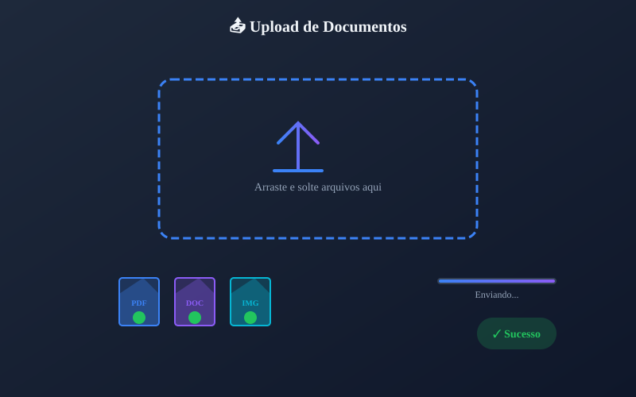

# Sistema de Gerenciamento de Documentos com IA

[](https://opensource.org/licenses/MIT)
[](https://www.python.org/downloads/)
[](https://nodejs.org/)

Sistema inteligente de gerenciamento de documentos com OCR, análise de sentimentos, extração de entidades e comparação de documentos utilizando IA.

---

## 🎯 Demo em Tempo Real

### 📤 1. Upload de Documentos
Arraste e solte arquivos para processamento automático com OCR.



---

### 🧠 2. Processamento com IA
Extração de texto, análise de sentimento e identificação de entidades em tempo real.


---

### ⚖️ 3. Comparação de Documentos
Compare versões de documentos e identifique diferenças automaticamente.


---

### 📊 4. Dashboard Analítico
Acompanhe estatísticas e atividade de processamento de documentos.



---

## 🚀 Funcionalidades

| Funcionalidade | Descrição |
|----------------|-----------|
| **📤 Upload** | Drag-and-drop de PDF, DOCX, TXT, PNG, JPG (máx. 50MB) |
| **🔍 OCR Avançado** | Extração de texto de documentos digitalizados (Tesseract) |
| **🧠 Análise IA** | Sentimento, entidades nomeadas e resumos automáticos |
| **⚖️ Comparação** | Highlight de diferenças lado a lado com % de similaridade |
| **🔒 Segurança** | Criptografia AES-256, autenticação Supabase, RBAC |
| **📊 Dashboard** | Estatísticas em tempo real e histórico de processamento |
| **🔎 Busca Semântica** | Encontre documentos por significado, não apenas palavras |

---

## 📋 Requisitos

- Node.js 18+
- Python 3.11+
- Docker (opcional, para containerização)
- Conta Supabase (gratuita)

---

## 🛠️ Instalação

### Opção 1: Docker (Recomendado)

```bash
# Clone o repositório
git clone https://github.com/seu-usuario/docmanager-ia.git
cd docmanager-ia

# Suba todos os serviços
docker-compose up -d

# Acesse http://localhost:3000
```

### Opção 2: Manual

#### Backend

```bash
cd project/backend
python -m venv venv
venv\Scripts\activate  # Windows
source venv/bin/activate  # Linux/Mac
pip install -r requirements.txt
cp .env.example .env
# Edite .env com suas credenciais do Supabase
python -m uvicorn main:app --reload
```

#### Frontend

```bash
cd project/frontend
npm install
cp .env.example .env
# Edite .env com suas credenciais do Supabase
npm run dev
```

---

## 🏗️ Arquitetura

```
┌─────────────────┐
│   Frontend      │
│  React + Vite   │
│   (Port 3000)   │
└────────┬────────┘
         │ HTTP/REST
         ▼
┌─────────────────┐
│   Backend       │
│   FastAPI       │
│   (Port 8000)   │
└────────┬────────┘
         ├──► Supabase Storage (Arquivos)
         └──► PostgreSQL (Metadados)
```

### Tecnologias

| Camada | Tecnologias |
|--------|-------------|
| **Frontend** | React 18, Vite, TypeScript, TailwindCSS, Zustand |
| **Backend** | FastAPI, Python 3.11, Pydantic |
| **OCR** | Tesseract, PyMuPDF |
| **IA/NLP** | Transformers, difflib |
| **Storage** | Supabase, PostgreSQL |
| **DevOps** | Docker, Docker Compose, GitHub Actions |

---

## 📚 Documentação

- [📐 Arquitetura do Sistema](project/docs/arquitetura.md)
- [📖 API Reference](project/docs/api.md)
- [🤝 Guia de Contribuição](project/docs/CONTRIBUTING.md)
- [⚙️ SETUP](SETUP.md)
- [📝 Code Review](CODE_REVIEW.md)

---

## 🔒 Segurança

- ✅ Criptografia AES-256 para documentos sensíveis
- ✅ Autenticação via Supabase Auth com RBAC
- ✅ Conformidade LGPD/GDPR
- ✅ Rate limiting na API
- ✅ Validação de tipo e tamanho de arquivo
- ✅ Sanitização de nomes de arquivo
- ✅ CORS configurável por ambiente

---

## 🧪 Testes

```bash
# Frontend
cd project/frontend
npm test

# Backend
cd project/backend
pytest
```

---

## 📂 Estrutura do Projeto

```
sistema-de-gerenciamento/
├── .github/workflows/     # CI/CD Pipeline
├── assets/                # Demo SVGs animados
├── project/
│   ├── frontend/          # React + Vite
│   │   ├── src/
│   │   │   ├── components/
│   │   │   ├── pages/
│   │   │   └── store/
│   │   └── package.json
│   ├── backend/           # FastAPI
│   │   ├── services/
│   │   ├── storage/
│   │   ├── utils/
│   │   └── main.py
│   └── docs/              # Documentação
├── docker-compose.yml
└── README.md
```

---

## 🎯 Plano de Desenvolvimento

| Fase | Descrição | Status |
|------|-----------|--------|
| **Fase 1** | Limpeza, .gitignore, README, estrutura | ✅ Concluída |
| **Fase 2** | Backend básico + migração OCR/extração | ✅ Concluída |
| **Fase 3** | Autenticação, segurança, comparação | ✅ Concluída |
| **Fase 4** | Análise IA avançada e UI polishing | ✅ Concluída |
| **Fase 5** | Testes, Docker e deploy | ✅ Concluída |

---

## 📝 Licença

MIT License - ver [LICENSE](LICENSE)

---

<div align="center">

**Feito com ❤️ e IA**

[⬆ Voltar ao topo](#sistema-de-gerenciamento-de-documentos-com-ia)

</div>