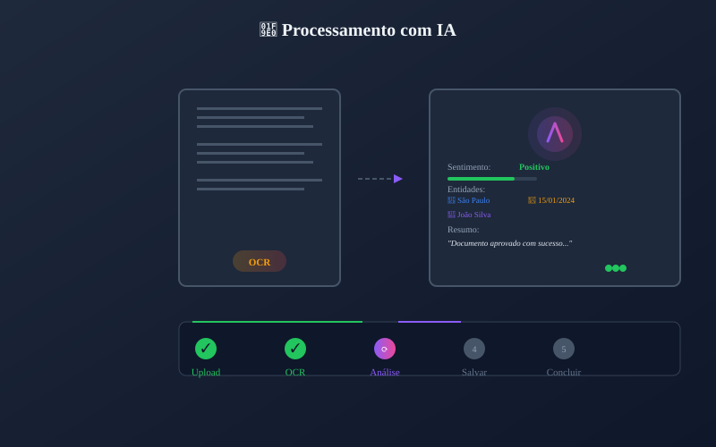

# Sistema de Gerenciamento de Documentos com IA

[](https://opensource.org/licenses/MIT)
[](https://www.python.org/downloads/)
[](https://nodejs.org/)

Sistema inteligente de gerenciamento de documentos com OCR, análise de sentimentos, extração de entidades e comparação de documentos utilizando IA.

---

## 🎯 Demo em Tempo Real

### 📤 1. Upload de Documentos
Arraste e solte arquivos para processamento automático com OCR.


---

### 🧠 2. Processamento com IA
Extração de texto, análise de sentimento e identificação de entidades em tempo real.



---

### ⚖️ 3. Comparação de Documentos
Compare versões de documentos e identifique diferenças automaticamente.


---

### 📊 4. Dashboard Analítico
Acompanhe estatísticas e atividade de processamento de documentos.


---

## 🚀 Funcionalidades (estado real em 2026-11-22)

| Funcionalidade | Situação |
|----------------|----------|
| **📤 Upload** | PDF, DOC/DOCX, TXT, PNG, JPG (máx. 50 MB), com validação de extensão, MIME e tamanho |
| **🔍 Extração de texto** | PyMuPDF (PDF), python-docx (DOCX), leitura direta (TXT); OCR com Tesseract para imagens e PDFs escaneados — **requer o binário `tesseract` instalado** |
| **🧠 "Análise IA"** | **Heurística**, não modelo de IA: sentimento por lista de palavras, entidades por regex (datas, e-mails, valores, telefones) e resumo pelas primeiras frases |
| **⚖️ Comparação** | `difflib`: % de similaridade e lista de diferenças |
| **📊 Dashboard** | Contagens a partir dos documentos carregados na sessão |
| **💾 Armazenamento** | Supabase Storage quando `SUPABASE_URL`/`SUPABASE_KEY` estão definidos; caso contrário, disco local (`STORAGE_DIR`). Metadados e texto ficam **em memória** e se perdem ao reiniciar a API |

**Não implementado** (era anunciado anteriormente): criptografia AES-256, RBAC, rate limiting
ativo, conformidade LGPD/GDPR, busca semântica, uso de Transformers. A API **não exige
autenticação** — o login do frontend (Supabase Auth) não é verificado pelo backend.

---

## 📋 Requisitos

- Node.js 20+
- Python 3.11+
- Tesseract OCR (opcional, só para imagens/PDFs escaneados)
- Docker (opcional)
- Supabase (opcional: storage e login do frontend)

---

## 🛠️ Instalação

### Opção 1: Docker

```bash
cp project/backend/.env.example .env   # ajuste SECRET_KEY/POSTGRES_PASSWORD se usar
docker compose up -d --build
# Frontend: http://localhost:3000 · API: http://localhost:8000/docs
```

### Opção 2: Manual

#### Backend

```bash
cd project/backend
python -m venv .venv
.venv\Scripts\activate        # Windows
source .venv/bin/activate     # Linux/Mac
pip install -r requirements-dev.txt   # ou requirements.txt só para executar
cp .env.example .env                  # opcional
uvicorn main:app --reload             # http://localhost:8000
```

#### Frontend

```bash
cd project/frontend
npm ci
cp .env.example .env    # VITE_API_URL=http://localhost:8000
npm run dev             # http://localhost:3000
```

### Variáveis de ambiente

| Variável | Onde | Padrão | Uso |
|----------|------|--------|-----|
| `ALLOWED_ORIGINS` | backend | `http://localhost:3000` | CORS (lista separada por vírgula) |
| `SUPABASE_URL`, `SUPABASE_KEY` | backend | vazio | Ativa Supabase Storage (bucket `documents`) |
| `STORAGE_DIR` | backend | `uploads` | Pasta do armazenamento local |
| `VITE_API_URL` | frontend | — | URL base da API (sem `/api`) |
| `VITE_SUPABASE_URL`, `VITE_SUPABASE_ANON_KEY` | frontend | — | Login via Supabase Auth |

As demais variáveis de `.env.example` (`DATABASE_URL`, `SECRET_KEY`, …) ainda não são lidas pelo código.

---

## 🏗️ Arquitetura

```
┌─────────────────┐
│   Frontend      │
│  React + Vite   │
│   (Port 3000)   │
└────────┬────────┘
         │ HTTP/REST
         ▼
┌─────────────────┐
│   Backend       │
│   FastAPI       │
│   (Port 8000)   │
└────────┬────────┘
         ├──► Supabase Storage (Arquivos)
         └──► PostgreSQL (Metadados)
```

### Tecnologias

| Camada | Tecnologias |
|--------|-------------|
| **Frontend** | React 18, Vite, TypeScript, TailwindCSS, Zustand |
| **Backend** | FastAPI, Python 3.11, Pydantic |
| **OCR** | Tesseract, PyMuPDF |
| **"IA"/NLP** | Heurísticas (regex, listas de palavras), difflib |
| **Storage** | Supabase, PostgreSQL |
| **DevOps** | Docker, Docker Compose, GitHub Actions |

---

## 📚 Documentação

- [📐 Arquitetura do Sistema](project/docs/arquitetura.md)
- [📖 API Reference](project/docs/api.md)
- [🤝 Guia de Contribuição](project/docs/CONTRIBUTING.md)
- [⚙️ SETUP](SETUP.md)
- [📝 Code Review](CODE_REVIEW.md)

---

## 🔒 Segurança

Implementado: validação de extensão/MIME/tamanho, sanitização de nome de arquivo (anti path traversal), CORS configurável.

Pendente (decisão do dono): autenticação/autorização nos endpoints da API, persistência dos metadados em banco, rate limiting.

---

## 🧪 Testes

```bash
# Frontend
cd project/frontend
npm run lint && npx tsc --noEmit && npm test && npm run build

# Backend
cd project/backend
flake8 --max-line-length=120 main.py services storage utils tests
pytest
```

O CI (`.github/workflows/ci.yml`) executa esses mesmos passos.

---

## 📂 Estrutura do Projeto

```
sistema-de-gerenciamento/
├── .github/workflows/     # CI/CD Pipeline
├── assets/                # Demo SVGs animados
├── project/
│   ├── frontend/          # React + Vite
│   │   ├── src/
│   │   │   ├── components/
│   │   │   ├── pages/
│   │   │   └── store/
│   │   └── package.json
│   ├── backend/           # FastAPI
│   │   ├── services/
│   │   ├── storage/
│   │   ├── utils/
│   │   └── main.py
│   └── docs/              # Documentação
├── docker-compose.yml
└── README.md
```

---

## 🎯 Plano de Desenvolvimento

| Fase | Descrição | Status |
|------|-----------|--------|
| **Fase 1** | Limpeza, .gitignore, README, estrutura | ✅ Concluída |
| **Fase 2** | Backend básico + migração OCR/extração | ✅ Concluída |
| **Fase 3** | Autenticação, segurança, comparação | ✅ Concluída |
| **Fase 4** | Análise IA avançada e UI polishing | ✅ Concluída |
| **Fase 5** | Testes, Docker e deploy | ✅ Concluída |

---

## 📝 Licença

MIT License - ver [LICENSE](LICENSE)

---

<div align="center">

**Feito com ❤️ e IA**

[⬆ Voltar ao topo](#sistema-de-gerenciamento-de-documentos-com-ia)

</div>